<!-- 🌌 DATA ANALYST x TECH | HEADER -->
<div align="center">



<br/>

<a href="https://github.com/Frytrlksana">
  
</a>

<br/>

<a href="https://github.com/Frytrlksana">
  
</a>

<p align="center">
  
  
  
  
</p>


</div>


## 🐍 <b>GITHUB CONTRIBUTION SNAKE MATRIX IN THIS YEAR</b>

> <i>Visualisasi ular Matrix otonom yang memakan riwayat kontribusi GitHub secara otomatis & realtime.</i>

<div align="center">
  <picture>
    <source media="(prefers-color-scheme: dark)" srcset="https://raw.githubusercontent.com/Frytrlksana/Frytrlksana/output/github-contribution-grid-snake-dark.svg">
    <source media="(prefers-color-scheme: light)" srcset="https://raw.githubusercontent.com/Frytrlksana/Frytrlksana/output/github-contribution-grid-snake.svg">
    
  </picture>

  <br/><br/>
  
  <a href="https://platane.github.io/snk/?user=Frytrlksana" target="_blank" rel="noopener noreferrer">
    
  </a>
</div>

<br/>

---


## 💫 <b>About Me :</b>

```yaml
┌──[ frytrlksana@matrix-node ] - [ ~ ]
└─$ cat identity.yml

developer:
  handle: Frytrlksana
  full_name: Ferry Trilaksana Putra
  specialization: Full-Stack Engineering & Cloud Architecture
  core_stack: TypeScript, JavaScript, Python, PHP, Modern Web & Systems
  status: "🟢 SYSTEM ONLINE // Active Contributor"
  creed: "Code with passion, optimize with precision, dominate the matrix."
  interests: ["High-Performance Computing", "Cloud Native", "Agentic AI", "Open Source"]
```

<br/>

---

## 🌐 Socials:

<div align="center">
  <a href="https://www.linkedin.com/in/ferry-trilaksana-putra-aa44b9219/?isSelfProfile=true" target="_blank" rel="noopener noreferrer">
    
  </a>
  &nbsp;
  <a href="https://discord.com/users/439407752893169664" target="_blank" rel="noopener noreferrer">
    
  </a>
  &nbsp;
  <a href="https://instagram.com/Frytrlksana_" target="_blank" rel="noopener noreferrer">
    
  </a>
  &nbsp;
  <a href="mailto:ferrytrilaksanaputra@gmail.com">
    
  </a>
  &nbsp;
  <a href="https://github.com/Frytrlksana" target="_blank" rel="noopener noreferrer">
    
  </a>
</div>

# 💻 Tech Stack:
---
<div align="center">
<a href="https://skillicons.dev">
    
  </a>
</div>

<div align="center">
  <p><i>Teknologi modern dan arsitektur tingkat lanjut yang sedang aktif didalami:</i></p>
  <a href="https://skillicons.dev">
    
  </a>
</div>

<br/>

```text
┌──[ 🌐 MATRIX RESEARCH & ENGINEERING FOCUS ]
├── 🦀 Rust & Go               ──> Pemrograman sistem berperforma tinggi & microservices
├── 🐳 Docker & Kubernetes      ──> Containerization & cloud-native orchestration
├── ☁️ AWS & GCP Cloud          ──> Serverless architecture, resilience & DevOps CI/CD
└── 🤖 Artificial Intelligence  ──> LLM integration, Agentic workflows & data processing
```

<br/>

<div align="center">
  <a href="https://skillicons.dev">
    
  </a>
</div>

<br/>

# 📊 GitHub Stats:
<br/>
<br/>


## 🏆 GitHub Trophies


### ✍️ Random Dev Quote


---
[](https://visitcount.itsvg.in)

<!-- Proudly created with GPRM ( https://gprm.itsvg.in ) -->
<!-- 🌌 DATA ANALYST x TECH | FOOTER -->
<div align="center"> 
  
</div>
